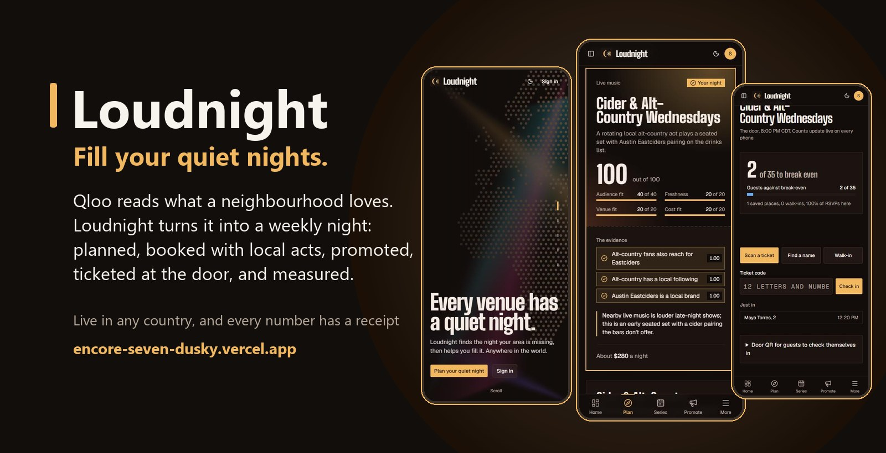
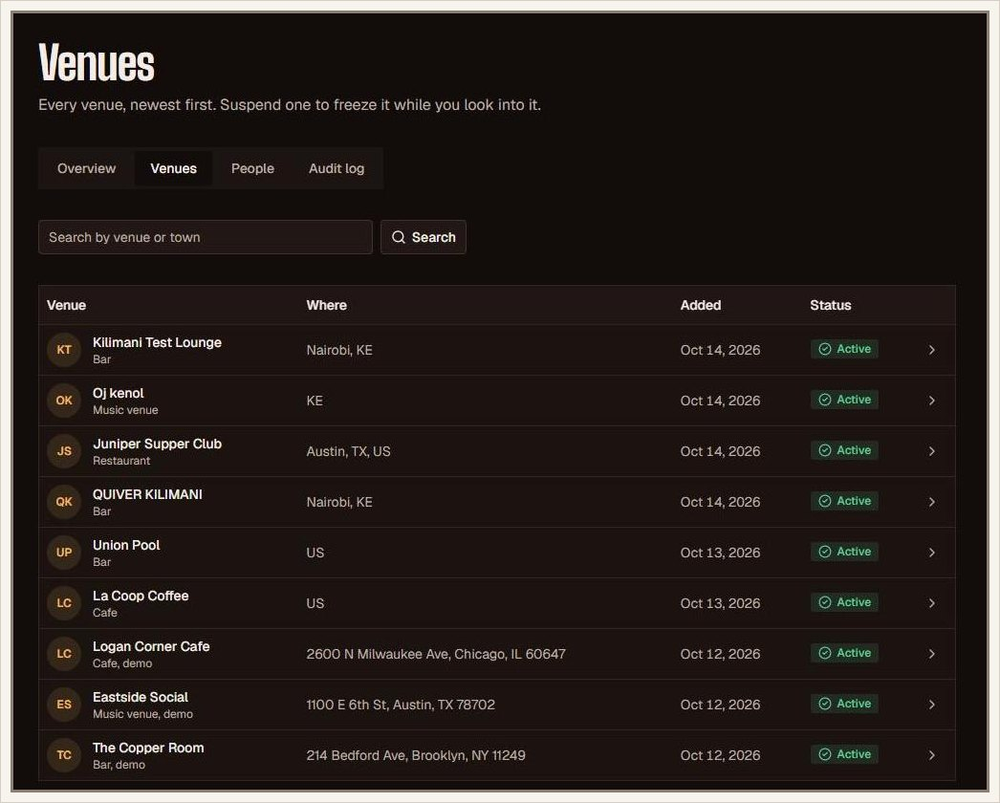

<p align="center">
  
</p>

<p align="center">
  <a href="https://encore-seven-dusky.vercel.app"></a>
  <a href="https://encore-seven-dusky.vercel.app/demo/8f6a1f8e-2c1b-4c55-9d2e-0b7a3c1e0001"></a>
  <a href="https://encore-seven-dusky.vercel.app/e/cider-alt-country-wednesdays-wed-oct-21-6726"></a>
</p>

<p align="center">
  
  
  
  
  
  <a href="https://github.com/Hopp-Murithi/encore/actions/workflows/ci.yml"></a>
  
</p>

> **Qloo knows what a neighbourhood loves. Loudnight turns that into people through the door on a Tuesday.**

Loudnight is a programming director for bars, cafes, restaurants and small music venues. An owner enters their address and their slow nights. Loudnight reads the neighbourhood's taste through [Qloo](https://www.qloo.com), finds what nobody nearby is running, invents a weekly night backed by evidence, books local acts the budget can afford, makes the ads, fills the guest list, runs the door, and shows who actually came against break-even. It is built, live, and works in any country and currency.

Built for the Qloo hackathon (submissions close Oct 30, 2026). The brief: [`docs/reference/encore-system-brief.pdf`](docs/reference/encore-system-brief.pdf).

## Contents

|                                                   |                                                     |                                             |
| ------------------------------------------------- | --------------------------------------------------- | ------------------------------------------- |
| [Try it in 60 seconds](#try-it-in-60-seconds)     | [Plans: Free and Premium](#plans-free-and-premium)  | [How it is built](#how-it-is-built)         |
| [The problem](#the-problem)                       | [For investors](#for-investors-what-25000-does)     | [What is built today](#what-is-built-today) |
| [See it work](#see-it-work-a-wednesday-in-austin) | [How Loudnight uses Qloo](#how-loudnight-uses-qloo) | [Roadmap](#roadmap)                         |
| [The judging criteria](#the-judging-criteria)     | [By the numbers](#by-the-numbers)                   | [Run it yourself](#run-it-yourself)         |

## Try it in 60 seconds

No account needed for the first three.

| Step | Open                                                                                                                             | What to look for                                                                                                                                   |
| ---- | -------------------------------------------------------------------------------------------------------------------------------- | -------------------------------------------------------------------------------------------------------------------------------------------------- |
| 1    | [The landing page](https://encore-seven-dusky.vercel.app)                                                                        | Scroll once per scene: the story zooms into your own country.                                                                                      |
| 2    | [A finished plan for The Copper Room, Brooklyn](https://encore-seven-dusky.vercel.app/demo/8f6a1f8e-2c1b-4c55-9d2e-0b7a3c1e0001) | Three scored nights. **Tap any number**: it opens the exact Qloo request and answer it came from. Compare with the plain chatbot answer beside it. |
| 3    | [A live event page](https://encore-seven-dusky.vercel.app/e/cider-alt-country-wednesdays-wed-oct-21-6726)                        | What a guest sees: the night, the booked acts, and a place to save a seat that gives them a ticket QR.                                             |
| 4    | [Start your own venue](https://encore-seven-dusky.vercel.app/signup)                                                             | Pick your country, find your venue, choose your quiet nights. About a minute later you have three nights planned for your street.                  |

## The problem

Most bars, cafes and restaurants are half empty two or three nights a week, and those nights still pay rent, staff and stock. Owners know they should run "something", but not what their neighbourhood would come for, who could play it, how to tell people, or whether it worked. Event tools sell tickets; marketing tools post ads; none of them tell a venue **what night to run**.

**What Loudnight does, in plain words:**

1. **Tell it your quiet nights.** Your address, up to three slow nights, what the room can host, and your budget. Two minutes.
2. **Get three nights worth running.** Loudnight reads what people near you love, checks what the venues around you already run, and suggests three regular nights nobody nearby offers. Every number has its source one tap away.
3. **Pick one and it is planned for four weeks.** Each week has its own twist, plus local performers your budget can stretch to, from your own country first, with a message ready to send them.
4. **Promote it.** Posters, stories and short videos with the performers' photos, captions for each network, and an event page where guests save a place.
5. **Run the door and see who came.** Scan tickets with the door app or tap names on any phone. The count updates live on every screen, against the number you need to break even.

## See it work: a Wednesday in Austin

A full run on Oct 14 with a made-up restaurant, Juniper Supper Club on South Congress, Austin. Its quiet nights are Wednesday and Tuesday, it hosts live music and comedy, and its performer budget is $400. Loudnight planned the Wednesday in about three minutes. Its pick, **Cider & Alt-Country Wednesdays**, scored 100. Two local bands were booked, the poster and captions named them, and the first night went live. A guest saved a place from a signed-out phone, their ticket was scanned on a second phone, and the door screen on a third went from 0 to 2 of 35 without a reload.

<h3>1. Plan the night</h3>
<table>
  <tr>
    <td align="center" valign="top" width="33%">
      <br>
      <b>The story</b><br>
      The landing page zooms into the visitor's own country
    </td>
    <td align="center" valign="top" width="33%">
      <br>
      <b>Home</b><br>
      Two quiet nights, one chosen, and the next step
    </td>
    <td align="center" valign="top" width="33%">
      <br>
      <b>The pick</b><br>
      Scored 100, with each piece of evidence one tap from its source
    </td>
  </tr>
</table>

<h3>2. Book and promote</h3>
<table>
  <tr>
    <td align="center" valign="top" width="33%">
      <br>
      <b>Local performers</b><br>
      Booked acts first, each labelled for the budget
    </td>
    <td align="center" valign="top" width="33%">
      <br>
      <b>The poster</b><br>
      Both booked acts, the date, and a QR to the tickets
    </td>
    <td align="center" valign="top" width="33%">
      <br>
      <b>The event page</b><br>
      What a guest opens to save a place
    </td>
  </tr>
</table>

<h3>3. Run the night</h3>
<table>
  <tr>
    <td align="center" valign="top" width="33%">
      <br>
      <b>The ticket</b><br>
      Any phone camera opens it; staff check the guest in from it
    </td>
    <td align="center" valign="top" width="33%">
      <br>
      <b>The door</b><br>
      Updated live on every phone: 2 of 35 to break even
    </td>
    <td align="center" valign="top" width="33%">
      <br>
      <b>Results</b><br>
      Tonight's count while the night is on, then each night's takings
    </td>
  </tr>
</table>

<h3>4. Run the platform</h3>
<p align="center">
  <br>
  <b>The administrator console</b><br>
  Every venue and person with a detail panel each, suspension, deactivation, every plan, the audit log, and read-only preview
</p>

## The judging criteria

| Criterion                        | What Loudnight brings                                                                                                                                                                                                                                                                                                                                | Check it                                                                                                                                                                |
| -------------------------------- | ---------------------------------------------------------------------------------------------------------------------------------------------------------------------------------------------------------------------------------------------------------------------------------------------------------------------------------------------------- | ----------------------------------------------------------------------------------------------------------------------------------------------------------------------- |
| **Technological Implementation** | Qloo drives five stages of a six-step planner (about 35 calls a plan); Claude chooses which taste pairings to test and Qloo confirms each one; every number is stored with its Qloo request and **the database refuses a number that is not in the stored answer**; multi-tenant security in Postgres; 500+ unit tests and database rule tests in CI | [How Loudnight uses Qloo](#how-loudnight-uses-qloo), tap any number in the [demo plan](https://encore-seven-dusky.vercel.app/demo/8f6a1f8e-2c1b-4c55-9d2e-0b7a3c1e0001) |
| **Design**                       | One finished journey: address, plan, series, performers, ads, event page, tickets, door, results, administration. Phone first, light and dark, every empty, loading and error state designed, plus a native door app                                                                                                                                 | [See it work](#see-it-work-a-wednesday-in-austin)                                                                                                                       |
| **Potential Impact**             | A real problem with real money: break-even on every screen, live door counts, each night's takings, and a working product in any country and currency (tested in Austin and Nairobi)                                                                                                                                                                 | [For investors](#for-investors-what-25000-does)                                                                                                                         |
| **Quality of the Idea**          | Taste data used on the supply side: it helps the venue decide what to run, not a consumer decide what to watch. Nights combine tastes across domains (music with food, film with a night out) that Qloo confirms locally, beside a plain chatbot answer that shows why that matters                                                                  | The plan page's "Generic AI" comparison                                                                                                                                 |

## Plans: Free and Premium

Planned pricing. During the hackathon every feature is open to everyone; billing is on the roadmap.

|                                         | **Free**                                       | **Venue** (Premium)                                              | **Group**                |
| --------------------------------------- | ---------------------------------------------- | ---------------------------------------------------------------- | ------------------------ |
| Price                                   | $0                                             | **$49 a month** (KES 2,500, £39)                                 | **$199 a month**         |
| Venues                                  | 1                                              | 1                                                                | Up to 5, one bill        |
| Quiet nights planned                    | 1                                              | Up to 3                                                          | Up to 3 at each venue    |
| Fresh plans                             | 1 a month                                      | As many as you need                                              | As many as you need      |
| Evidence receipts on every number       | Yes                                            | Yes                                                              | Yes                      |
| Four-week series with a twist each week | Yes                                            | Yes                                                              | Yes                      |
| Local performers                        | The top 3                                      | Full list, fresh lists, budget labels, ready messages, booking   | Same, across venues      |
| Ads                                     | Posters with the Loudnight mark                | Posters, stories, banners and video, no mark, Spanish captions   | Same                     |
| Event page and RSVPs                    | Up to 50 a night                               | Unlimited                                                        | Unlimited                |
| The door                                | Web door screen                                | The door app, team roles for managers and door staff             | Same, every venue        |
| Results                                 | Tonight's count                                | Every night's takings, the monthly gain, what the plan pays back | Every venue side by side |
| Paid tickets (when live)                | 3% booking fee paid by the guest, capped at $1 | Same                                                             | Same                     |

**What each plan does for the owner**

| Plan  | Who it is for                               | What it does for them                                                                                                                                                 |
| ----- | ------------------------------------------- | --------------------------------------------------------------------------------------------------------------------------------------------------------------------- |
| Free  | A venue trying it out                       | Finds the night its neighbourhood is missing and runs it once, with a guest list and a door screen.                                                                   |
| Venue | A bar, cafe or restaurant with quiet nights | Fills one to three quiet nights every week. At Juniper's numbers, one extra full night (35 guests at $38) is about $1,330 of sales: more than two years of Loudnight. |
| Group | A hospitality group or promoter             | Runs every venue's weekly nights, team and results from one place.                                                                                                    |

## For investors: what $25,000 does

**What it is.** One app that takes a venue from "Tuesday is dead" to a planned, promoted, ticketed and measured weekly night. It is built and live, and the same code serves Austin in dollars and Nairobi in shillings.

### Proof it works: one venue, start to finish (the Austin run, Oct 14)

| Step                | What happened                                                                                        | Owner's time                 |
| ------------------- | ---------------------------------------------------------------------------------------------------- | ---------------------------- |
| Set up the venue    | Address, two quiet nights, budget $400, what the room hosts                                          | 2 minutes                    |
| Plan                | 35 Qloo calls, nearby venues and events checked, 3 nights scored with evidence                       | About 3 minutes, automatic   |
| Choose and schedule | "Cider & Alt-Country Wednesdays" (score 100) became 4 dated nights                                   | 1 click                      |
| Book performers     | 10 local acts suggested with budget labels; 2 booked, each with a ready message                      | A few minutes                |
| Promote             | Poster, story and video with both acts' photos, captions for each network                            | Automatic                    |
| Fill the room       | Event page live; a guest saved a place from a signed-out phone                                       | Under a minute for the guest |
| Run the door        | The ticket QR was scanned on a second phone; the door screen on a third went from 0 to 2 of 35, live | Seconds per guest            |

**Under 10 minutes of the owner's time from an address to a promoted night with a guest list and a working door**, and every number on screen can be traced to its source.

### What one venue is worth

|                             | Amount                                                                                                                                       |
| --------------------------- | -------------------------------------------------------------------------------------------------------------------------------------------- |
| Price to the venue          | $49 a month (KES 2,500, £39); groups of up to five venues $199                                                                               |
| Our cost to serve one venue | Under $1 a month at one plan a month: about $0.30 of AI calls a plan, and Qloo answers are cached and shared by area                         |
| Gross margin                | Above 95% before Qloo's commercial price, which is the number that sets the real margin                                                      |
| Value to the venue          | Juniper's break-even is 35 guests at $38 each, about $1,330 of sales a night. One extra full night pays for more than two years of Loudnight |
| Later, on paid tickets      | A 3% booking fee paid by the guest, capped at $1; the venue pays nothing extra for a full room                                               |

### Where the $25,000 goes

| Use                                | Amount      | What it buys                                                                                                                                                                      |
| ---------------------------------- | ----------- | --------------------------------------------------------------------------------------------------------------------------------------------------------------------------------- |
| Meeting venues in person           | $7,000      | Travel to meet promoters, club, bar and restaurant owners and event organisers, starting in Nairobi and Mombasa, then Kampala and Lagos; onboarding the first 100 venues hands on |
| Advertising to owners              | $6,000      | Instagram, TikTok and Google campaigns aimed at venue owners, tested city by city                                                                                                 |
| The door app and payments          | $5,000      | The React Native door app on real phones and in the stores, M-Pesa and card ticketing, payouts to venues                                                                          |
| Running the platform for 12 months | $4,000      | Qloo, Claude, Supabase, Vercel, Google Places and SMS                                                                                                                             |
| Legal, compliance and buffer       | $3,000      | Company set-up, data protection (Kenya's Data Protection Act, GDPR), terms, payment provider checks                                                                               |
| **Total**                          | **$25,000** |                                                                                                                                                                                   |

### Targets for the next twelve months (targets, not results)

| By       | Target                                        | Monthly subscription revenue                       |
| -------- | --------------------------------------------- | -------------------------------------------------- |
| Month 3  | 30 paying venues in Nairobi                   | $1,470                                             |
| Month 6  | 100 venues in two cities, paid ticketing live | $4,900, plus booking fees                          |
| Month 12 | 300 venues                                    | $14,700 (about $176,000 a year), plus booking fees |

Booking fees at month 12, as an illustration: 300 venues x 4 nights a month x 40 tickets x $0.30 (3% of a $10 ticket) = $14,400 a month, about as much again as subscriptions.

**Assumptions, stated so they can be checked:** 4 in 10 venue meetings start a free plan; 1 in 4 free venues upgrades; winning a paying venue costs under $60 (in person plus ads), so its margin pays that back in about six weeks; fewer than 1 in 20 venues leave each month. The administrator console tracks the inputs from the first month: venues, plans, published nights, RSVPs and check-ins.

### Why it can win

- **A working product, not slides**: live, and run end to end in Austin and Nairobi.
- **Data nobody else uses this way**: Qloo's taste data turned into nights a venue can run, with every number backed by a stored receipt.
- **Local first**: a venue in Kenya gets Kenyan performers first, prices in shillings and its own time zone.
- **Built to be trusted with money**: every venue's data walled off by the database itself, an audited administrator console, venue suspension, and read-only "preview as" for support.

## How Loudnight uses Qloo

Qloo answers the question no venue tool can: what do the people who live around this address actually love? Loudnight asks it at every stage and keeps every answer.

| Stage                  | What Loudnight asks Qloo (all `/v2/insights` near the venue)                                                                                                                                                      |
| ---------------------- | ----------------------------------------------------------------------------------------------------------------------------------------------------------------------------------------------------------------- |
| Read the neighbourhood | Eleven areas of taste: music and night-out tags, then artists, films, TV, brands, books, podcasts, people and destinations, with a popularity cap so local names surface instead of global stars                  |
| Who the crowd is       | `urn:demographics` for the night's tastes: the age bands it leans to                                                                                                                                              |
| What is already on     | `urn:entity:place` within 2 km, next to Google Places and Ticketmaster, so the night fills a real gap                                                                                                             |
| Invent the nights      | The planner (Claude) calls a `check_overlap` tool: does one taste really pull another here? Qloo confirms or refutes each pairing, such as alt-country fans and a local cider                                     |
| Find performers        | Artists or people whose fans share the night's tastes, the area's own favourites, the area's own sound (`filter.tags`), and national names kept apart as style references; Qloo's popularity sets each act's size |

**No number without a receipt.** Every Qloo answer is stored in `qloo_cache` with its request. Every number on screen keeps the stored row and the JSON path of its value, and the database refuses one that is not there. One tap shows the request and the answer. Answers are reused for a week and kept after a refresh, so old receipts still open. Planning one night made about 35 Qloo calls in the Austin run; a second plan for the same area reuses most of them from the cache.

Where Qloo is thin, other sources fill in, always labelled: Wikidata for local musicians, poets, comedians and DJs, and MusicBrainz for town and country musicians. Each act says "From Wikidata" or "From MusicBrainz" and never shows a Qloo receipt it does not have. One check gives every act a home country and a star flag, so a venue's own country comes first and household names it could never book are left out.

<details>
<summary><b>Feedback for Qloo</b>: what we learned from probes in East Austin, Williamsburg, Logan Square, Nairobi and Nyeri</summary>

- **Popularity is global, not local.** Diamond Platnumz scores 0.58 and Harmonize 0.13, so to a Nairobi venue they read as small acts, though both are East African stars. A popularity within a country or around a location would make "can this venue book them?" much more accurate.
- **Affinity saturates near 1.0, and the top results repeat across cities.** We cap popularity (`filter.popularity.max`) to bring local names forward. A documented way to rank by what is distinctive to an area would help every local use case.
- **Silent ignoring costs time.** Invalid parameters return 200 with an empty list. `signal.location.radius` changed nothing in our tests. `signal.location.weight=high` made results less relevant. Occupation tags such as `urn:tag:occupation:wikidata:comedian` are ignored by insights. A warning field naming ignored parameters would save developers hours.
- **Home-grown artists are thin outside the biggest markets.** Only two artists carry the `urn:tag:genre:music:kenyan` tag, and there is no gengetone or benga tag. Asking who fans of Kenyan music follow returns Nigerian, Jamaican and US names, because it describes the fans, not the artists. A nationality or hometown field on artists would let Qloo answer "who from here plays this sound" directly.
- **Poets and comedians are thin.** Genre tags find DJs well, but a Nairobi search found no comedians.
- **Small things:** `filter.location` needs WKT (`lat,lng` returns 400). `urn:entity:video_game` returns 400 on the hackathon host. Short descriptions are often untagged by language. One entity can carry several Spotify accounts.
- **What worked well:** location tags differ clearly by neighbourhood (East Austin: alt-country, Americana, blues; Williamsburg: indie, experimental). Overlap queries answer fast. `place_of_birth` and Spotify listeners in the entity made local-first booking possible.

</details>

## By the numbers

|                      |                                                                                             |
| -------------------- | ------------------------------------------------------------------------------------------- |
| Planner              | 6 fixed steps, streamed live; Claude chooses the tools inside a step, never the order       |
| Taste read per venue | 11 areas of taste from Qloo                                                                 |
| One plan             | About 35 Qloo calls, 3 scored nights, about 3 minutes                                       |
| Score                | 40 x audience fit + 20 x novelty + 20 x venue fit + 20 x cost fit, computed by the database |
| Tests                | 500+ unit tests, plus database rule tests for every role, preview and suspension            |
| Schema               | 19 migrations; row level security on every table                                            |
| Apps                 | The web app (Next.js) and the door app (React Native, Expo) on one API                      |
| Reach                | Any country, currency and time zone; 237 countries in the venue search                      |

## How it is built

**Where it runs**: the web app on [Vercel](https://encore-seven-dusky.vercel.app), data, sign-in and live updates on [Supabase](https://supabase.com) (Postgres), taste data from [Qloo](https://www.qloo.com), reasoning and copy from [Claude](https://www.anthropic.com), places from Google, events from Ticketmaster, and checks on every push in [GitHub Actions](.github/workflows/ci.yml).

```
Browser or door app
  component -> hook -> api.ts -> /api/v1 route -> service -> repository -> Supabase Postgres (row level security)
                                                     \-> lib/qloo, lib/places, lib/ticketmaster, lib/ai, lib/wikidata, lib/musicbrainz
```

- **The tenant is the venue.** Every venue's rows share one database, and Postgres itself refuses to show a row to someone who should not see it, so the code cannot forget to filter. Door staff never see money; guests read nothing back.
- **No number without a receipt.** Every Qloo answer is cached; every evidence chip stores the cached row and the JSON path of its value; a database trigger refuses a value that is not there.
- **Three gates**: the proxy, the route wrappers, and row level security. A hidden button is never the control.
- **Trust and governance**: an administrator console with suspension, deactivation and an audit log written by database triggers, and read-only "preview as" that the database enforces.

| Technology                                                            | Version          | Used for                                                      |
| --------------------------------------------------------------------- | ---------------- | ------------------------------------------------------------- |
| [Next.js](https://nextjs.org)                                         | 16.3.6           | App Router, route handlers under `/api/v1`, `proxy.ts`        |
| [React](https://react.dev)                                            | 19.2.8           | User interface                                                |
| [TypeScript](https://www.typescriptlang.org)                          | 5.9.3            | Strict typing everywhere                                      |
| [Tailwind CSS](https://tailwindcss.com)                               | 4.3.3            | Styling with design tokens for light and dark                 |
| [shadcn/ui](https://ui.shadcn.com) on [Base UI](https://base-ui.com)  | 4.21.0 / 1.8.0   | Component source in `src/components/ui`                       |
| [Supabase JS](https://supabase.com/docs/reference/javascript) and SSR | 2.117.2 / 0.12.7 | Postgres, Auth, Realtime                                      |
| [Anthropic SDK](https://docs.anthropic.com)                           | 0.131.0          | Claude Sonnet 5.5 for planning and checks, Haiku 5.5 for copy |
| [Zod](https://zod.dev)                                                | 4.6.5            | One schema for forms, API bodies and upstream responses       |
| [TanStack Query](https://tanstack.com/query)                          | 5.104.0          | Client data cache and mutations                               |
| [Vitest](https://vitest.dev)                                          | 5.0.2            | Unit tests                                                    |
| [Expo](https://expo.dev) and React Native                             | SDK 57 / 0.86.3  | The door app in [`apps/door`](apps/door/README.md)            |

Every version is pinned exactly. Full reasoning: [`docs/architecture/ARCHITECTURE.md`](docs/architecture/ARCHITECTURE.md).

<details>
<summary><b>Project layout</b></summary>

```
src/app            Routing only: pages, layouts, /api/v1 route handlers
src/components     ui (shadcn), layout, shared, forms, providers
src/config         Constants: site, roles, venues, series, pricing, integrations
src/lib            env, http, supabase, ai, qloo, places, ticketmaster, wikidata, musicbrainz, format
src/modules        One folder per business area: schemas, repository, service, api, hooks, components
apps/door          The React Native door app (Expo)
supabase           migrations, seed.sql (demo venues), tests (row level security and suspension), config.toml
docs               architecture (ARCHITECTURE.md, plans), roadmap, screenshots, reference (the brief)
```

</details>

<details>
<summary><b>Roles</b></summary>

| Role          | Who                        | Can                                                                        |
| ------------- | -------------------------- | -------------------------------------------------------------------------- |
| Administrator | Runs Loudnight             | Everything; suspends venues, deactivates people, previews anyone read only |
| Venue owner   | Whoever created the venue  | Everything at their venue, including the team and money settings           |
| Venue manager | Invited by the owner       | Plans, series, nights, settings, spend                                     |
| Door staff    | Invited by the owner       | Guest list and check-ins; never money                                      |
| Guest         | Anyone with the event link | RSVP and check in; reads nothing back                                      |

</details>

## What is built today

| Area                    | Built and live                                                                                                                                                                |
| ----------------------- | ----------------------------------------------------------------------------------------------------------------------------------------------------------------------------- |
| Landing                 | One pinned stage in five scenes; one scroll moves one scene; the story zooms into the visitor's own country                                                                   |
| Venues anywhere         | Pick the country first, then search inside it; time zone, town, currency from the place; money in the venue's own currency                                                    |
| The room                | What it can host (live music, DJs, poetry, comedy and more), seated or standing, up to three quiet nights, each with its own plan, series and ads                             |
| Planning                | The six-step planner streams its trace and proposes three scored nights with a receipt on every number, beside a plain chatbot answer                                         |
| Series and performers   | Four weeks on the calendar; home-country acts first, household names and non-performers left out, budget labels, ready messages, booking                                      |
| Promote                 | Posters, stories, banners and short videos drawn in the browser, with the booked acts' photos, a ticket QR, Spanish copy and captions for each network                        |
| Event pages and tickets | Guests save a place signed out; the ticket QR opens on any camera; staff check them in from it; a ticket counts once                                                          |
| The door and results    | Scan, find a name or count walk-ins; counts update live on every phone; each night against break-even                                                                         |
| The door app            | React Native (first version, [`apps/door`](apps/door/README.md)): camera scanning that uses tickets up, live counts, walk-ins, and arrivals kept offline until they sync once |
| Running the platform    | Administrator console: venues and people as tables with detail panels, plans, audit log, suspension, deactivation, read-only preview                                          |
| Demo venues             | Finished plans anyone can open without an account                                                                                                                             |

Every plan, its status and its gate: [`docs/architecture/plans/README.md`](docs/architecture/plans/README.md).

## Roadmap

| Next                             | What it adds                                                                                                                 |
| -------------------------------- | ---------------------------------------------------------------------------------------------------------------------------- |
| The door app in the stores       | Real phones, EAS builds, sound on each scan                                                                                  |
| The door control room            | Real-time messages to door staff, live arrivals, the till sending takings into results, gate cameras viewed beside the count |
| Paid tickets and payouts         | M-Pesa and cards, a wallet for each venue, withdrawals, tickets that cannot be used twice                                    |
| The learning loop                | Each night's turnout decides the next: keep, tweak or swap                                                                   |
| Point of sale and social posting | Takings from the till, ads posted straight to Instagram, Facebook and TikTok                                                 |
| Local trends                     | Chart and search trends near the venue beside Qloo's taste                                                                   |

Details, costs and order: [`docs/roadmap.md`](docs/roadmap.md).

## Run it yourself

Needs Node 22 or newer. Point `.env.local` at a Supabase project (hosted, or local with Docker and the [Supabase CLI](https://supabase.com/docs/guides/cli)).

```bash
npm install
cp .env.example .env.local     # fill in the values; check:connections tells you which keys work, without printing them
npm run check:connections
npm run dev                    # http://localhost:3000
```

<details>
<summary><b>Scripts</b></summary>

| Command                     | What it does                                                                  |
| --------------------------- | ----------------------------------------------------------------------------- |
| `npm run dev`               | Development server                                                            |
| `npm run validate`          | Dashes, typecheck, lint, format check, tests and build. Run before every push |
| `npm run db:test`           | Every `supabase/tests/*.sql` against the local database                       |
| `npm run db:types`          | Regenerates `src/types/database.ts` from the local schema                     |
| `npm run check:connections` | Proves Supabase, Qloo, Places, Ticketmaster and Anthropic answer              |
| `npm run demo:precompute`   | Rebuilds the demo venues' plans, series and performers                        |
| `npm test`                  | Unit tests                                                                    |
| `npm run format`            | Prettier                                                                      |

The door app: see [`apps/door/README.md`](apps/door/README.md).

</details>

**Contributing**: read [`CLAUDE.md`](CLAUDE.md) (every rule is mandatory), pick the active plan in [`docs/architecture/plans`](docs/architecture/plans), and run `npm run validate` and `npm run db:test` before every push.

**Documentation**: [`CLAUDE.md`](CLAUDE.md) (the rules), [`ARCHITECTURE.md`](docs/architecture/ARCHITECTURE.md) (the design and why), [`plans`](docs/architecture/plans) (plans 00 to 32, gates, judging criteria, traceability), [`roadmap.md`](docs/roadmap.md) (money, the door app, payments, point of sale, trends), [`docs/reference`](docs/reference) (the brief).

## Licence

MIT. See [`LICENSE`](LICENSE).
