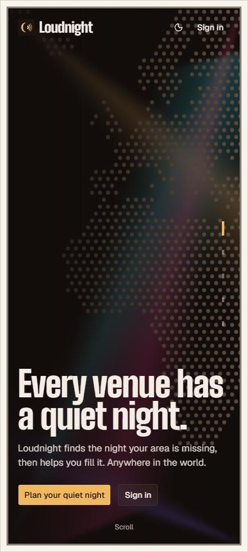
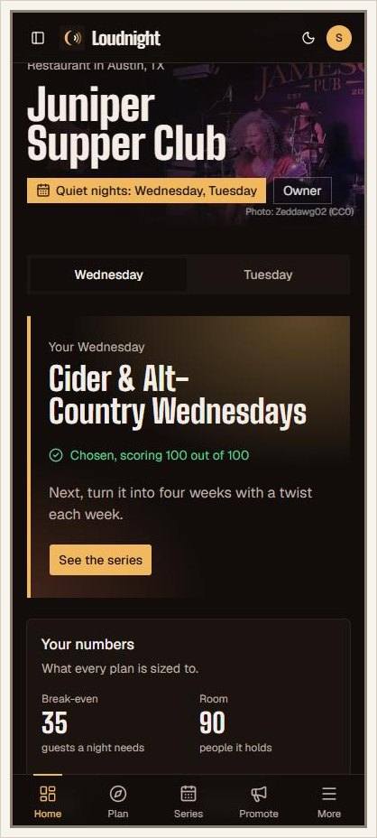
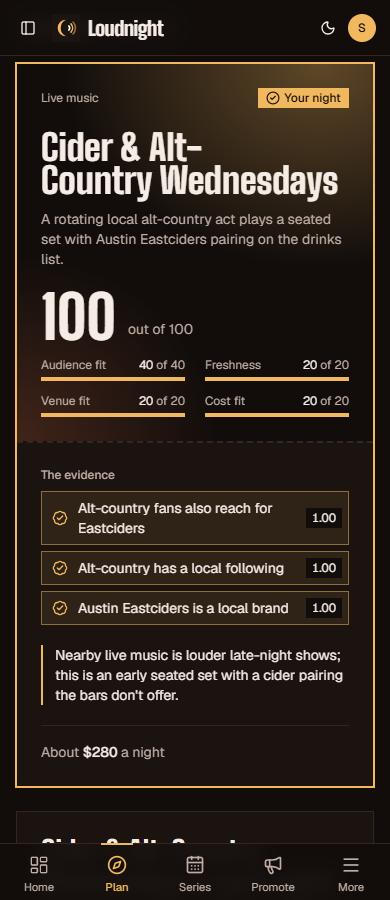
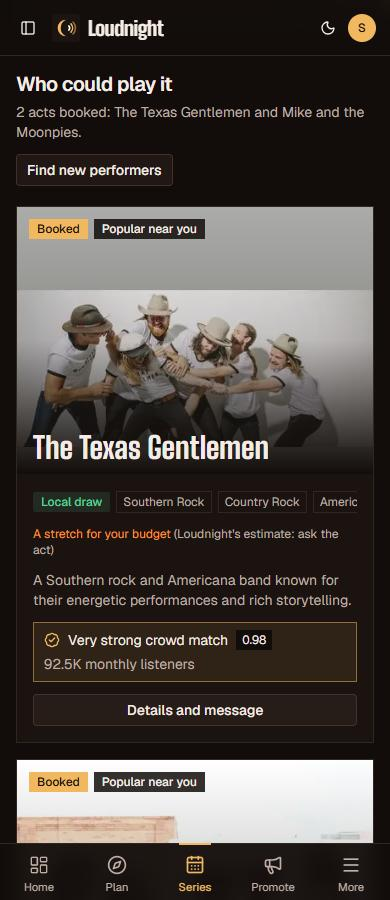
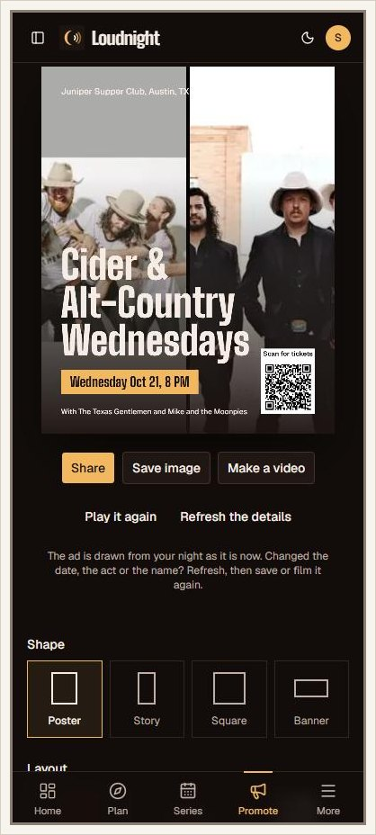
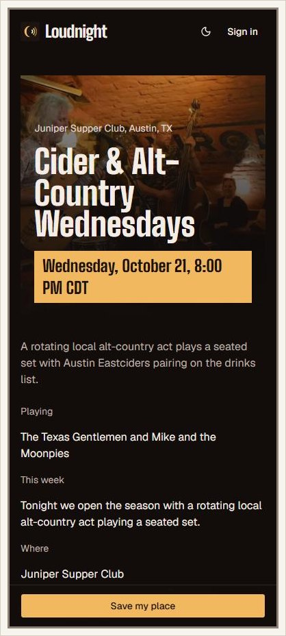
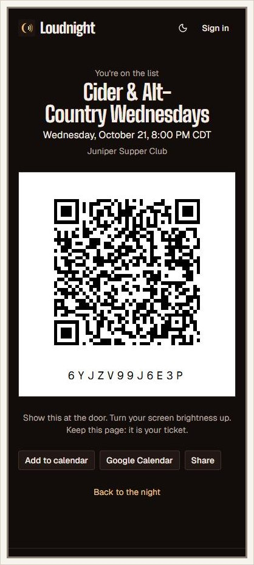
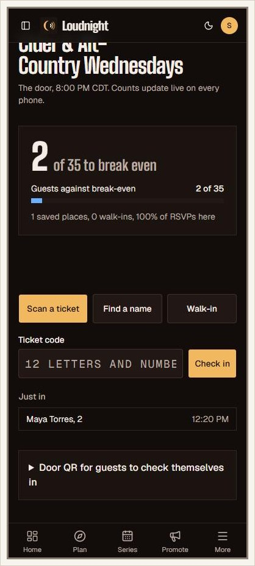
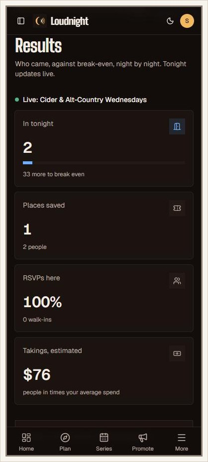

# Loudnight

Fill your quiet nights. Loudnight is a programming director for bars, cafes, restaurants and small music venues. An owner enters their address and their slow night. Loudnight reads the neighbourhood's taste through [Qloo](https://www.qloo.com), finds what nobody nearby is running, invents a recurring event backed by evidence, finds the talent, produces the launch kit, and measures who actually came.

> Qloo knows what a neighbourhood loves. Loudnight turns that into people through the door on a Tuesday.

Live: https://encore-seven-dusky.vercel.app

Built for the Qloo hackathon (submissions close Oct 30, 2026). The full brief is in [`docs/reference/encore-system-brief.pdf`](docs/reference/encore-system-brief.pdf).

## What it does for a venue

For the owner of a bar, cafe or restaurant, in plain words:

1. **Tell it your quiet nights.** Your address, up to three slow nights, what the room can host, and your budget. Two minutes.
2. **Get three nights worth running.** Loudnight reads what people near you love, checks what the venues around you already run, and suggests three regular nights nobody nearby offers. Every number has its source one tap away.
3. **Pick one and it is planned for four weeks.** Each week has its own twist, plus local performers your budget can stretch to, with a message ready to send them.
4. **Promote it.** Posters, stories and short videos with the performers' photos, captions for each network, and an event page where guests save a place.
5. **Run the door and see who came.** Scan tickets or tap names on any phone. The count updates live on every screen, against the number you need to break even.

## Contents

1. [See it work](#see-it-work-a-wednesday-in-austin)
1. [How Loudnight uses Qloo](#how-loudnight-uses-qloo)
1. [Why it can be a business](#why-it-can-be-a-business)
1. [Status](#status)
1. [Tech stack](#tech-stack)
1. [Architecture in one minute](#architecture-in-one-minute)
1. [Getting started](#getting-started)
1. [Scripts](#scripts)
1. [Project layout](#project-layout)
1. [Roles](#roles)
1. [Contributing](#contributing)
1. [Documentation map](#documentation-map)

## See it work: a Wednesday in Austin

A full run on Oct 14 with a made-up restaurant, Juniper Supper Club on South Congress, Austin. Its quiet nights are Wednesday and Tuesday, it hosts live music and comedy, and its performer budget is $400. Loudnight planned the Wednesday in about three minutes. Its pick, **Cider & Alt-Country Wednesdays**, scored 100. Two local bands were booked, the poster and captions named them, and the first night went live. A guest saved a place from a signed-out phone, and their ticket was scanned on a second phone. The door screen on a third went from 0 to 2 of 35 without a reload.

<table>
  <tr>
    <td align="center"><br><sub>The story, in the visitor's own country</sub></td>
    <td align="center"><br><sub>Home: two quiet nights, one chosen</sub></td>
    <td align="center"><br><sub>The pick, its score and its evidence</sub></td>
  </tr>
  <tr>
    <td align="center"><br><sub>Local acts, booked, sized to the budget</sub></td>
    <td align="center"><br><sub>The poster names and shows both acts</sub></td>
    <td align="center"><br><sub>The event page a guest opens</sub></td>
  </tr>
  <tr>
    <td align="center"><br><sub>The guest's ticket: any camera opens it</sub></td>
    <td align="center"><br><sub>The door, updated live: 2 of 35</sub></td>
    <td align="center"><br><sub>Results while the night is on</sub></td>
  </tr>
</table>

## How Loudnight uses Qloo

Qloo answers the question no venue tool can: what do the people who live around this address actually love? Loudnight asks it at every stage and keeps every answer.

| Stage                  | What Loudnight asks Qloo (all `/v2/insights` near the venue unless noted)                                                                                                                                                |
| ---------------------- | ------------------------------------------------------------------------------------------------------------------------------------------------------------------------------------------------------------------------ |
| Read the neighbourhood | Eleven areas of taste: music and night-out tags (`urn:tag` by tag type), then artists, films, TV, brands, books, podcasts, people and destinations, with a popularity cap so local names surface instead of global stars |
| Who the crowd is       | `urn:demographics` for the night's tastes: the age bands it leans to                                                                                                                                                     |
| What is already on     | `urn:entity:place` within 2 km, next to Google Places and Ticketmaster, so the night fills a real gap                                                                                                                    |
| Invent the nights      | The planner (Claude) calls a `check_overlap` tool: does one taste really pull another here? Qloo confirms or refutes each pairing, such as alt-country fans and a local cider                                            |
| Find performers        | Artists or people whose fans share the night's tastes, the area's own favourites, and national names kept apart as style references; Qloo's popularity sets each act's size                                              |

**No number without a receipt.** Every Qloo answer is stored in `qloo_cache` with its request. Every number on screen keeps the stored row and the JSON path of its value, and the database refuses one that is not there. One tap shows the request and the answer. Answers are reused for a week and kept after a refresh, so old receipts still open. Planning one night made about 35 Qloo calls in the Austin run; a second plan for the same area reuses most of them from the cache.

Where Qloo is thin, other sources fill in, and they are always labelled. For poets, comedians and DJs, Loudnight uses Wikidata, and for town musicians, MusicBrainz. Each act says "From Wikidata" or "From MusicBrainz" and never shows a Qloo receipt it does not have.

### Feedback for Qloo

What we learned building on the hackathon API, from probes run in East Austin, Williamsburg, Logan Square, Nairobi and Nyeri:

- **Popularity is global, not local.** Diamond Platnumz scores 0.58 and Harmonize 0.13, so to a Nairobi venue they read as small acts, though both are East African stars. A popularity within a country or around a location would make "can this venue book them?" much more accurate.
- **Affinity saturates near 1.0, and the top results repeat across cities.** We cap popularity (`filter.popularity.max`) to bring local names forward. A documented way to rank by what is distinctive to an area would help every local use case.
- **Silent ignoring costs time.** Invalid parameters return 200 with an empty list. `signal.location.radius` changed nothing in our tests. `signal.location.weight=high` made results less relevant. Occupation tags such as `urn:tag:occupation:wikidata:comedian` are ignored by insights, so the answer is the same for every occupation. A warning field naming ignored parameters would save developers hours.
- **Home-grown artists are thin outside the biggest markets.** Only two artists carry the `urn:tag:genre:music:kenyan` tag (`filter.tags`), and there is no gengetone or benga tag. Asking who fans of Kenyan music follow (`signal.interests.tags`) returns Nigerian, Jamaican and US names, because it describes the fans, not the artists. Loudnight now checks each act's home country itself and fills the gap from Wikidata and MusicBrainz, but a nationality or hometown field on artists would let Qloo answer "who from here plays this sound" directly.
- **Poets and comedians are thin.** Genre tags find DJs well, but a Nairobi search found no comedians. Better coverage of live performers beyond musicians would open comedy, poetry and talks nights.
- **Small things:** `filter.location` needs WKT (`lat,lng` returns 400). `urn:entity:video_game` returns 400 on the hackathon host. Short descriptions are often untagged by language. One entity can carry several Spotify accounts.
- **What worked well:** location tags differ clearly by neighbourhood (East Austin: alt-country, Americana, blues; Williamsburg: indie, experimental). Overlap queries answer fast. `place_of_birth` and Spotify listeners in the entity made local-first booking possible.

## Why it can be a business

- **Revenue:** $49 a month per venue (KES 2,500, £39), $199 for a group of up to five. Later, a 3% booking fee on paid tickets, paid by the guest and capped at $1. One extra night of 35 guests at $25 is $875; even half that pays for the year.
- **Cost:** about $0.30 of model calls per plan before Qloo, and Qloo answers are cached and shared by area. The margin is high once Qloo's contract price is known.
- **Scale:** one shared database with every venue walled off by row level security, every plan precomputable, and work split into short streamed steps that fit any host's time limit. Any country, currency and time zone already works.
- **Adaptability:** a bar, cafe, restaurant or club; live music, DJs, poetry, comedy, quizzes, talks or film. Up to three quiet nights. New taste and performer sources slot in behind the same receipt rule.
- **Usability:** built for a phone. Plain words, no setup, a door screen with large targets, and everything works signed out for guests.

Full plan: [`docs/roadmap.md`](docs/roadmap.md) covers pricing, paid tickets, the owner's wallet and payouts, point of sale, posting to social networks and local trends.

## Status

Built and live (Oct 14), in the order an owner meets them:

- **Landing page**: one pinned stage in five scenes. One scroll moves one scene. The story zooms into the visitor's own country (from the request's IP country, never stored; `/?region=kenya` shows any region).
- **Venues anywhere**: pick the country first, then search inside it. Time zone, town, country and currency come from the Google place, and money is shown in the venue's own currency.
- **The room**: what it can host (live music, DJs, poetry, comedy and more), seated or standing, and up to three quiet nights, each with its own plan, series and ads.
- **Planning**: the six-step planner streams its trace, reads the area's taste through Qloo, scans what nearby venues and events already run, and proposes three scored nights with a receipt on every number.
- **Series and performers**: four weeks on the calendar; performers popular near the venue first, a fresh list on each look, booking messages ready to send. Each act is labelled for the budget, household names are kept out, and Wikidata and MusicBrainz add poets, comedians, DJs and town musicians.
- **Promote**: posters, banners and short videos drawn in the browser, with the booked acts' photos, a ticket QR, Spanish copy and captions for each channel.
- **Event pages and tickets**: publish a night, and guests save a place signed out. Their ticket's QR opens on any camera, and staff check them in from it.
- **The door and results**: scan, find a name or count walk-ins. Counts update live on every phone, and results show each night against break-even.
- **Readiness**: what is ready for the chosen night and what is not, on Home.
- **Demo venues**: finished plans anyone can open without an account.

Next: the administrator console (plan 08), the learning loop (plan 14), and the installable app (plan 15). Every plan, its status and its gate: [`docs/architecture/plans/README.md`](docs/architecture/plans/README.md).

## Tech stack

Every version is pinned exactly in `package.json`. Do not use ranges.

| Technology                                                            | Version          | Used for                                                |
| --------------------------------------------------------------------- | ---------------- | ------------------------------------------------------- |
| [Next.js](https://nextjs.org)                                         | 16.3.6           | App Router, route handlers under `/api/v1`, `proxy.ts`  |
| [React](https://react.dev)                                            | 19.2.8           | User interface                                          |
| [TypeScript](https://www.typescriptlang.org)                          | 5.9.3            | Strict typing everywhere                                |
| [Tailwind CSS](https://tailwindcss.com)                               | 4.3.3            | Styling with design tokens for light and dark           |
| [shadcn/ui](https://ui.shadcn.com) on [Base UI](https://base-ui.com)  | 4.21.0 / 1.8.0   | Component source in `src/components/ui`                 |
| [Supabase JS](https://supabase.com/docs/reference/javascript) and SSR | 2.117.2 / 0.12.7 | Postgres, Auth (anonymous sessions), Realtime           |
| [Anthropic SDK](https://docs.anthropic.com)                           | 0.131.0          | Claude Sonnet 5.5 for planning, Haiku 5.5 for copy      |
| [Zod](https://zod.dev)                                                | 4.6.5            | One schema for forms, API bodies and upstream responses |
| [TanStack Query](https://tanstack.com/query)                          | 5.104.0          | Client data cache and mutations                         |
| [Vitest](https://vitest.dev)                                          | 5.0.2            | Unit tests                                              |

Also pinned: `qrcode-generator` 2.0.4 (QR codes on ads and tickets, no dependencies).

External services: Qloo Insights API, Google Places API (New), Ticketmaster Discovery API (optional per country), Wikidata and MusicBrainz (open data), Anthropic. Hosting: Vercel. CI: GitHub Actions (`.github/workflows/ci.yml`).

## Architecture in one minute

A layered modular monolith with shared-schema multi-tenancy. The tenant is the venue, and Postgres row level security enforces it.

```
component -> hook -> api.ts -> /api/v1 route -> service -> repository -> Supabase (RLS)
                                                   \-> lib/qloo, lib/places, lib/ticketmaster, lib/ai
```

- **The planner** runs six fixed steps: scout, read the neighbourhood, find the gap, generate concepts, score, plan. Claude picks the tools inside a step, never the order of the steps. Each step is its own streamed server call.
- **No number without a receipt.** Every Qloo answer is cached in `qloo_cache`. Every evidence chip stores the cached row and the JSON path of its value, and the database refuses a value that is not there.
- **Score** = 40 x audience fit + 20 x novelty + 20 x venue fit + 20 x cost fit, computed by the database.
- **Three gates**: `proxy.ts`, the route wrappers, RLS. A hidden button is never the control.
- **Preview as**: an administrator can see Loudnight as any owner or staff member, read only. The database enforces it.

Full reasoning: [`docs/architecture/ARCHITECTURE.md`](docs/architecture/ARCHITECTURE.md).

## Getting started

Needs Node 22 or newer, Docker, and the [Supabase CLI](https://supabase.com/docs/guides/cli). Without Docker you can point `.env.local` at a hosted Supabase project instead; database tests then run against that project.

```bash
npm install
supabase start                 # local Postgres, Auth, API, Realtime; applies migrations and seed
cp .env.example .env.local     # then fill in the values (see below)
npm run db:test                # PASS rls.sql
npm run dev                    # http://localhost:3000
```

For local development, `supabase start` prints the local URL, publishable key and secret key; put them in `.env.local`. For the hosted project, use its URL and keys instead. The Qloo, Google Places, Ticketmaster and Anthropic keys are needed only once the planner is built. `npm run check:connections` tells you which keys work, without printing them.

## Scripts

| Command                     | What it does                                                                  |
| --------------------------- | ----------------------------------------------------------------------------- |
| `npm run dev`               | Development server                                                            |
| `npm run validate`          | Dashes, typecheck, lint, format check, tests and build. Run before every push |
| `npm run db:test`           | Every `supabase/tests/*.sql` against the local database                       |
| `npm run db:types`          | Regenerates `src/types/database.ts` from the local schema                     |
| `npm run check:connections` | Proves Supabase, Qloo, Places, Ticketmaster and Anthropic answer              |
| `npm run demo:precompute`   | Rebuilds the demo venues' plans, series and performers                        |
| `npm test`                  | Unit tests                                                                    |
| `npm run format`            | Prettier                                                                      |

## Project layout

```
src/app            Routing only: pages, layouts, /api/v1 route handlers
src/components     ui (shadcn), layout, shared, forms, providers
src/config         Constants: site, roles, venues, journey, ai, integrations
src/lib            env, http, supabase, ai, qloo, places, ticketmaster, format
src/modules        One folder per business area: schemas, repository, service, api, hooks, components
supabase           migrations, seed.sql (demo venues), tests (RLS assertions), config.toml
docs               architecture (ARCHITECTURE.md, plans) and reference (the brief)
```

## Roles

| Role          | Who                        | Can                                                              |
| ------------- | -------------------------- | ---------------------------------------------------------------- |
| Administrator | Runs Loudnight             | Everything; previews anyone read only                            |
| Venue owner   | Whoever created the venue  | Everything at their venue, including the team and money settings |
| Venue manager | Invited by the owner       | Plans, series, nights, settings, spend                           |
| Door staff    | Invited by the owner       | Guest list and check-ins; never money                            |
| Guest         | Anyone with the event link | RSVP and check in; reads nothing back                            |

Judges and new owners need no account: demo venues are open to everyone, and starting a plan creates an anonymous session that can later be kept with an email.

## Contributing

1. Read [`CLAUDE.md`](CLAUDE.md). Every rule there is mandatory.
2. Pick the active plan in [`docs/architecture/plans`](docs/architecture/plans) and follow its Prompt section.
3. `npm run validate` and `npm run db:test` must pass before every push.
4. Tick plan boxes only for verified work.

## Documentation map

- [`CLAUDE.md`](CLAUDE.md): the rules
- [`docs/architecture/ARCHITECTURE.md`](docs/architecture/ARCHITECTURE.md): the design and why
- [`docs/architecture/plans`](docs/architecture/plans): the schedule, gates, judging criteria, traceability and plans 00 to 31
- [`docs/roadmap.md`](docs/roadmap.md): how Loudnight makes money, point-of-sale onboarding, posting to social networks, local trends
- [`docs/reference`](docs/reference): the Loudnight system brief

## Licence

MIT. See [`LICENSE`](LICENSE).
